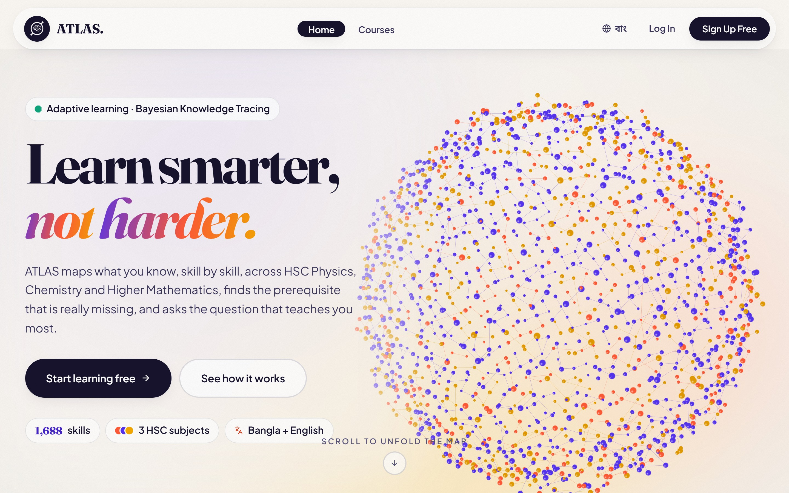

<div align="center">

# ATLAS

**Learn smarter, not harder.**

Adaptive tutoring for HSC Physics, Chemistry and Higher Mathematics,<br>
built on Bayesian Knowledge Tracing over a prerequisite skill graph.

<a href="https://atlas-indol-one.vercel.app/"></a>
&nbsp;
<a href="Final_report/Group07_ATLAS.pdf"></a>

**1,688** skills &nbsp;·&nbsp; **1,683** prerequisite links &nbsp;·&nbsp; **183** topics in **51** sections &nbsp;·&nbsp; **12,223** verified questions

<br>

<a href="https://atlas-indol-one.vercel.app/"></a>

</div>

## About

ATLAS is our CSE 450 Capstone project (Group 07, Department of CSE, BUET). It prepares
students for engineering university admission tests (BUET/KUET/RUET/CUET). Instead
of a flat question bank, it models what each learner knows, skill by skill, and
steps back to a missing foundation when that is why the learner is struggling.

| | |
|---|---|
| **Live app** | https://atlas-indol-one.vercel.app/ (sign up with any username and password) |
| **Live API** | https://atlas-api-5wjp.onrender.com/catalog |
| **Final report** | [`Final_report/Group07_ATLAS.pdf`](Final_report/Group07_ATLAS.pdf) (LaTeX source in [`Final_report/`](Final_report/)) |
| **Presentation** | [`Presentation/ATLAS_v2.pdf`](Presentation/ATLAS_v2.pdf), [defense Q&A](Presentation/ATLAS_Defense_QnA.pdf) |
| **Supervisor** | Dr. Md. Shariful Islam Bhuyan, Associate Professor, Dept. of CSE, BUET |
| **Team** | Sakif Naieb Raiyan (2105065), Sayaad Muzahid Masfi (2105066), Aurchi Chowdhury (2105083), Omar Abdur Razzaque (2105094), Rubaiyat-E-Zaman (2105104) |

> The API runs on Render's free tier and sleeps when idle. The first request after a
> pause can take about a minute while it wakes up.

## How it works

| Step | What ATLAS does |
|---|---|
| **Diagnose** | A short adaptive diagnostic sets a starting mastery for every skill in a section. |
| **Track** | Each answer updates that skill's mastery with Bayesian Knowledge Tracing, using guess and slip rates that depend on the question's Bloom level. A correct answer also raises the skills it depends on. |
| **Gate** | A skill only starts to count as learned once all of its direct prerequisites are mastered. |
| **Step back** | When 3 of the last 5 wrong answers point to the same missing prerequisite, it asks 2 questions on that skill, then returns to the topic. |
| **Map** | Every skill is shown coloured by mastery, with the links between them. |

Questions are in Bangla with LaTeX math. They were generated from six textbooks with
retrieval-augmented generation, and a second model re-solved each one before it was
kept.

```
Browser ──▶ Frontend (React + Vite, Vercel) ──HTTPS, bearer token──▶ API (FastAPI, Render) ──▶ Supabase (Postgres)
```

## Reproduce locally

**Requirements:** Python 3.11+, Node.js 18+, and a `Backend/.env` file holding the
Supabase credentials. That file is not in the repository because it contains a
secret key. We share it privately with evaluators.

### 1. Create `Backend/.env`

Copy [`Backend/.env.example`](Backend/.env.example) to `Backend/.env` and fill it in:

| Variable | Required | Purpose |
|---|---|---|
| `SUPABASE_URL` | yes | Supabase project URL |
| `SUPABASE_SERVICE_KEY` | yes | Supabase service-role key |
| `AUTH_SECRET` | recommended | Any long random string, used to sign login tokens. If unset, every restart logs everyone out. |
| `ADMIN_USERNAMES` | optional | Comma-separated admin usernames (default: none) |

The frontend needs no `.env` file. It calls `http://localhost:8000` by default.

### 2. Start the API (http://localhost:8000)

```bash
cd Backend
python -m venv .venv
.venv\Scripts\activate            # Windows  (macOS/Linux: source .venv/bin/activate)
pip install -r requirements.txt
uvicorn server:app --port 8000
```

Check it: http://localhost:8000/catalog should return JSON with a `courses` list.

### 3. Start the web app (http://localhost:5173)

In a second terminal:

```bash
cd Frontend
npm install
npm run dev
```

Open http://localhost:5173, sign up, choose a course and section, and take the
diagnostic. Then open the mastery map and practise a topic.

### 4. Run the tests (no credentials needed)

```bash
cd Backend
python smoke_test_engine.py        # expect: 54 passed, 0 failed
```

The test runs the full diagnostic, mastery update, topic practice and prerequisite
step-back flow, plus the sign-up, login and access-control checks, against an
in-memory copy of the database. It passes even without `Backend/.env`.

## Deployment

The live version uses the same code: the frontend is on **Vercel** (root directory
`Frontend/`, with `VITE_API_BASE_URL` set to the API URL), and the API is on
**Render**, built from [`Backend/Dockerfile`](Backend/Dockerfile) through
[`render.yaml`](render.yaml). Both use the same Supabase database. The full
walkthrough is in [DEPLOY.md](DEPLOY.md).

## Repository

| Path | Contents |
|---|---|
| [`Backend/`](Backend/) | FastAPI API: BKT engine, diagnostic, topic practice, auth, admin pages |
| [`Frontend/`](Frontend/) | React + Vite web app |
| [`data-gen/`](data-gen/) | Offline question-generation pipeline (RAG + Gemini, generate then verify) |
| [`Ontology/`](Ontology/) | Skill ontology built from the textbooks, with its validator and viewers |
| [`Prompts/`](Prompts/) | Every LLM prompt used to build the ontology and questions |
| [`Final_report/`](Final_report/) | Final report: PDF and LaTeX source |
| [`Presentation/`](Presentation/) | Presentation slides |

**Further reading:** [ARCHITECTURE.md](ARCHITECTURE.md) (design, API, database) ·
[DEPLOY.md](DEPLOY.md) (deployment) ·
[Mastery rules](BKT-DAG%20Policy%20For%20Skill%20Mastery.txt) (exact policy constants) ·
[CLAUDE.md](CLAUDE.md) (detailed setup and verification steps for AI agents)

<div align="center">


</div>
